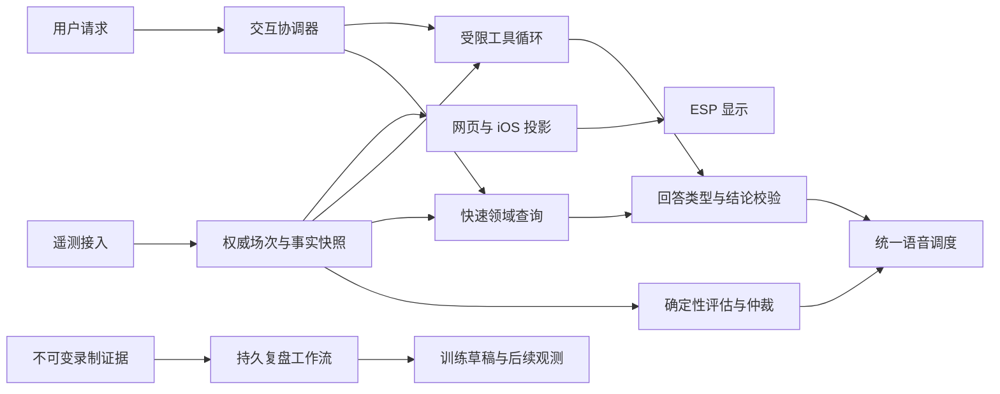

# Asurada 当前工作区架构建议

审阅日期：2026-09-15。面向隼人，依据当前包含未提交改动的工作区。

后续实施说明：本文件保留审阅时的问题证据。领域 bool/越界百分比与相关固定问答、LLM 摘要已在后续 A01/A04 实现中修复并定向验证；最新实施状态以 `ASURADA_ARCHITECTURE_IMPLEMENTATION_PLAN_CN.md` 为准，尚未完成全链质量传播。

## 结论

建议保留 Python 确定性赛车内核，将其与受限交互 Agent、持久赛后工作流明确分层。下一阶段最有价值的工作是贯通事实质量、工具结果、任务和实际交付契约，再围绕一个训练流程验证价值。

当前已有不少此前计划中的能力：有界收包、后台观察与规划、TaskContext、共享语音所有者、播放前复核、数值 claims、时间加权上下文和可恢复复盘。继续按旧报告从零新增这些模块会重复建设。真正需要补的是跨模块的语义和产品入口。

## 审阅范围和验证边界

本轮清点了六个源码区域，共 312 个源码文件、60,830 行：核心 118 文件/27,325 行；脚本 159/23,087；网页 5/2,258；iOS 19/5,202；ESP 6/384；采集工具 5/2,574。包含重复的工具源码，排除第三方依赖、构建产物、媒体和模型二进制；按 py/swift/mjs/js/cpp/h/html 扩展名统计。

所有清单内 Python 文件完成 AST 解析，无语法错误。重点阅读了实时入口、组帧、状态与策略、后台通道、语音与 LLM、工具、复盘、训练、模型准入以及多端接入代码。**文件清点和 AST 解析不等于全部源码逐行审计；本报告不声称已穷尽 60,830 行的所有分支。**

- 源码清单及哈希：`output/architecture-review-current/source-inventory.json`。
- 本轮 7 组离线回归通过，0 失败、0 跳过：domain_assessment、capability_executor、source_time_context、llm_numeric_claims、model_admission、training_plans、workflow_store。结果：`output/architecture-review-current/contracts/summary.json`。
- 额外边界探测：`output/architecture-review-current/boundary-probes.json`，发现问题见下文。
- 没有修改业务代码。没有完成全量顺序回放、真实模型供应商、真实麦克风/音频、iOS 或 ESP 实机验收。旧的 114 项通过记录早于后续 claims 和上下文改动，不能代替本版本综合验证。

## 当前真实运行结构

1. 实时：`__main__ → AsuradaApp.run_live_udp → BufferedPacketSource → StrategyRuntimePipeline → decoder/assembler → UnifiedStateStore → StrategyEngine`。实时入口启用后台观察模型、低频规划、异步日志和异步语音提交。
2. 交互：`VoiceInputCoordinator → 唤醒/快速意图/语义归一/路由 → 固定回答或 LlmExplainer → 语音输出`。仍以固定查询与解释为主，没有接入可组合工具循环。
3. 输出：`LiveSpeechSubmission / SpeechClient → SpeechService → ConsoleVoiceOutput → backend`。服务端已有停止屏障、场次核验、排队启动前复核及部分辅助提示距离窗口。
4. 复盘：独立脚本调用 `run_session_review → WorkflowStore → 正式圈索引/最近圈比较/区段分析/记忆/训练草稿/报告`；原始捕获另有投影步骤。训练激活和取消也有独立脚本入口。
5. 多端：网页消费核心生成的 payload；ESP 复用网页 Canvas 并发送带 CRC 的像素增量；iOS 桥接仍自行解析 UDP 并维护自己的遥测和车损状态。

图中受限工具循环和统一 iOS 投影属于建议目标；其余也不表示已全部验收。

## 建议一：先统一字段质量，而后扩大决策能力

优先级 P0。`packet_snapshot.py:247–261` 对油门、刹车、转向、ERS、轮胎磨损等存在补零路径。完整二进制解码通常提供这些字段，因此不能据此断言正常包都会缺字段；问题是边界异常或其他入口缺失后，零已经无法与真实观测区分。

`context_window.py` 已拒绝缺失/非法驾驶输入，并统计有效覆盖；但上游补出来的零仍会被它接受。`assessment.py:15` 的 `_nonnegative` 仅做 float 转换、有限和非负检查，不拒绝 bool，也不执行百分比上限。本轮实际调用 `assess_domain`：ERS=True 得到 low、轮胎磨损=True 得到 stable；ERS=150 得到 stable、磨损=150 得到 box_now。这是领域入口的验证缺口，不是对正常 F1 数据的断言。

建议为关键字段增加统一的值、单位、来源、观测时间和质量；先从驾驶输入、燃油、ERS、轮胎、车距、赛道控制开始。避免直接将全系统所有 float 一次性改为包装对象，可先增加集中式质量映射与访问接口，再迁移消费者。来源缺失的历史数据要保留 unknown，不能回填 observed。

验收：同一字段的真实零、缺失、过期、非法值，在规则、查询、模型和 UI 中有明确不同表现；无数据不等于安全或正常。时间窗口同时检查绝对覆盖和字段覆盖，不能仅因已覆盖部分中有效占比高就认为足够。

## 建议二：把语音契约拆为“回答类型”和“交付状态”

优先级 P0。`llm_explainer.py:485` 已区分 companion_chat；`speech_applicability.py:100` 却对所有 override 走数值验证并要求非空 reason_fields。验证器之间的策略没有对齐。

本轮实际调用共享服务使用的适用性函数，得到：

| 输入 | 当前结果 | 应有语义 |
| --- | --- | --- |
| needs_clarification：“你想比较什么？” | speech_answer_evidence_missing | 澄清问题可以没有比赛证据 |
| needs_clarification：“你想比较哪一圈？” | numeric_answer_requires_claims | “哪一圈”不是数值事实声明 |

建议定义 `race_fact / clarification / companion / control_ack` 等显式类型，并由调用方可信路由决定允许类型，不能仅相信模型自报。比赛事实严格绑定证据与数值；澄清限制为问题；陪聊不带过期赛况；控制回执绑定执行结果。校验策略由一处定义，explainer 与 service 共同调用。

`llm_claims.py` 的程序计算、单位检查及模板渲染应保留，但词法规则会误伤普通语句。数值 slots 解决数值正确性；“更快”“足够”“因为制动过晚”等比较和因果语义，需要另有受支持结论或假设类型，不能以引用存在代替结论成立。

另外，`VoiceInputCoordinator` 调用输出后直接返回 spoken/control_executed，而底层可能排队或抑制。统一 `accepted → queued → started → completed`，并提供 suppressed/cancelled/failed/delivery_unknown。界面和对话记忆只有收到相应事件后才能声称已经播报或执行。

## 建议三：让工具提供可组合结果，并接入实际交互链

优先级 P1。`CapabilitySpec.tool_schema()` 的输入为空对象，`CapabilityExecutor.execute()` 拒绝非空 arguments，handler 主体返回 `(speak_text, action_code)`。已有 54 个能力定义，其中 40 个有 handler，但数量不代表分析能力可组合。

调用追踪发现执行器已有独立 `scripts/query_snapshot_tool.py`，所以它不是完全未接入；然而 `VoiceInputCoordinator` / `LlmExplainer` 并未通过它调用工具。当前是可用的命令行查询能力，尚未成为交互 Agent 的执行层。

先增加六类结构化工具即可：当前评估、决定证据、圈比较、区段比较、进站预测依据、创建训练草稿。明确 session/epoch、lap IDs、segment ID、条件筛选等参数；结果返回值、单位、证据、质量、适用范围及版本。文案由独立 renderer 生成。

固定快速问答继续直达 handler；只有开放分析启用 `选择工具 → 执行 → 观察 → 决定结束` 的受限循环。复用 TaskContext，设置总 deadline、工具次数、LLM 次数、token/费用预算、取消及拒绝后的返回策略。草稿写入单独授权并使用幂等键。

验收使用一个真实问题：“最近三圈哪个区段波动最大，给我一项练习”。系统应调用结构化比较，输出带来源的结果，形成可激活草稿；不得从 speak_text 反向解析数值。增加能力后不应还要重复维护 `voice_input.py` 中的控制能力集合等多个列表。

## 建议四：补齐取消到资源释放，以及权威状态的交付协议

优先级 P0/P1。已有有界线程池和晚到丢弃，不能再描述成完全没有取消。但 `LlmExplainer.run()` 仅向 provider 传递剩余 timeout_ms；底层 Responses/Chat 使用 `urlopen`，命令后端使用 `subprocess.run`，未收到同一个取消信号。取消调用者不会立即终止这些 I/O；线程槽会保留到后端返回。

复用已有可取消 HTTP/进程执行基础设施，把 TaskContext 贯穿 provider、重试和后备请求；为响应体和子进程输出设置大小限制。对确实不能协作取消的原生任务再考虑进程隔离，保留明确的容量拒绝和恢复健康状态。

共享服务已从 `latest_snapshot.json` 校验权威状态，但该文件由独立异步 sink 发布，runtime 在日志发布前提交声音。两条异步路径没有一致的提交序号；不意味着每次必然出错，但不具备原子的“已发布事实再交付候选”保证。

建议核心发布带 sequence 的不可变 StateRevision，候选声明其依据 revision；输出按领域适用性检查最新 revision，并消费场次开始/结束/倒带/断流事件。保留最新文件给 UI/诊断，交付顺序需要明确确认协议。不能简单要求候选 snapshot_id 永远等于最新值，否则高频数据会让慢回答一直失效。

验收：取消立即停止交付且资源最终释放；重试不重置总预算；切场后旧结果不能生效；同场无关变化不误拒绝；真正发声的延迟和停止延迟单独测量。backend.start 前检查不等于云 TTS 完成后物理发声时仍有效。

## 建议五：用一个训练闭环证明 Agent 的价值

优先级 P1。`WorkflowStore` 已有 SQLite checkpoint、任务锁、超时和恢复，不需要再创建另一套任务数据库。当前工作流六步、原始捕获七步，已经具备可用的开发入口。

`corner_review.py` 对距离和圈时做插值、检查缺口、比较同天气/配胎/安全车条件。`training_plans.choose_focus()` 选三圈中区段耗时波动最大且达到 50 ms 的区段；激活后记录第一圈满足条件的观测。它能支持稳定性练习，还不能说明“你刹车太晚”或证明训练效果。

建议先贯通用户流程：查看区段证据 → 选择一个目标 → 激活草稿 → 执行 → 比较多次后续观测 → 保留/撤销。补制动开始距离、最低速度、油门恢复、出弯速度等可测特征，并把交通、燃油、磨损纳入可比性限制。事实、假设、用户偏好、经验证驾驶表现分开保存。

工作流代码在独立 memory/training 数据库产生副作用，而步骤 checkpoint 在 tasks 数据库提交。当前通过确定性 ID 和去重处理部分重跑；未来添加通知或外部写入时，须明确效果账本/outbox 或等价幂等协议，不能把 checkpoint 误认为跨库事务。

## 建议六：统一各端事实，不让每端成为另一套赛车内核

优先级 P1。网页已经主要读取核心投影，ESP 复用现有 Canvas 的方式适合保留。iOS `AppState.swift` 有 1,356 行，同时负责 USB/Wi-Fi、JSON/CSV、回放、车损判断和 Live Activity。

iOS 的 UDP bridge 直接 `struct.unpack_from`，头部解析丢弃 session UID、frame 与 overall frame。AppState 又按大量别名读取字段并补默认值，与核心 telemetry-v1/epoch/DecisionRecord 不一致，跨场和缺失语义因此难以跨端验证。

将 iOS 分为接入适配器、版本化 DTO、会话仓库、回放控制和展示模型；优先由核心提供权威投影。保留独立离线模式时，共用协议规范与 golden fixtures。投影至少携带 session_uid、epoch、revision、数据质量与 freshness，车损等级由核心输出或共同规范计算。

网页生产实现使用 `asurada.live_dashboard_payload`；`live-dashboard/payload.py` 另有旧实现，不能把后者当生产权威。清理重复定义前检查外部使用者；相似但未使用的代码会持续误导维护。

验收：同一录制输入在核心、网页、iOS 上的场次、圈边界、断流和等级一致；ESP 的 CRC/ACK 证明传输一致，实屏体验另验收。

## 建议七：模型准入绑定评估内容，发布绑定完整证据

优先级 P1/P2。默认模型为 observe/disabled；active 要求 evidence 引用和新上下文窗口声明；资产验证已检查模型哈希和特征列哈希。这些都是应保留的基础。

但 `ModelAdmissionPolicy` 只检查 evidence 字符串非空；特征列相同不代表计算语义相同。上下文刚从帧数窗口改成源时间窗口，模型评估必须绑定这一变化。建议准入记录包含模型 hash、特征实现版本、数据 manifest、标签来源、完整场次划分、适用域、校准报告、规则基线和行为差分，不仅是报告路径。

训练工具已按完整 session_uid 分割并检查未来窗口连续性；新增记录身份/标签逻辑仍需要实际完整数据导出复核。规则生成标签只能证明拟合规则，不能证明更高的驾驶收益。

发布至少绑定源码、配置、规则、模型与特征、工具 schema、依赖和验证报告。`pyproject.toml` 有 models/training/http-voice/local-asr，但 WS 后端使用的 websocket-client 尚无显式安装项；干净环境按能力安装和启动需要纳入验收。

## 建议八：按职责拆大模块，并减少实时重复工作

优先级 P2。`strategy.py` 1,173 行，混合评估、候选、模型、长周期规划、交互事件和文案；`output.py` 1,612 行，混合调度、辅助控制、渲染、后端和诊断。文件大本身不是缺陷，但这些职责的变化原因不同。

建议依赖方向为 adapters → application → domain，基础设施通过 port 注入。StrategyEngine 保留编排，候选生成/准入/仲裁独立；ConsoleVoiceOutput 拆调度、适用性、渲染和后端端口。公共契约先稳定，再挪动文件。

实时中还存在完整快照反复哈希、四路以上 deep copy、每帧构造交互和调试结构等工作。异步 sink 只移走写入，append 内 deepcopy 仍在实时线程。先在完整回放中量化这些开销，再采用一次构建的不可变 revision、共享只读投影、按需调试事件。暂不据静态代码断言已达性能瓶颈。

## 框架选择与实施顺序

不建议此时整体切换 LangChain/LangGraph 或将油胎、攻防等拆为多个自主 Agent。现有赛车规则、仲裁、生命周期和语音交付仍需要自己的领域协议。建议先保留模块化本地服务，只隔离需要独立生命周期的语音、阻塞模型和外部 I/O。

当前官方资料中，Anthropic 区分代码定义流程的 workflow 与模型动态决定步骤的 agent；LangGraph 提供 persistence/interrupts 等编排能力。这些能力适合在未来动态分支、人工暂停恢复明显超出已有 WorkflowStore 时，用赛后复盘做小范围验证。若迁移，一个流程只能有一个任务状态权威。

参考：[Anthropic agent/workflow 区分](https://www.anthropic.com/engineering/building-effective-agents)、[LangGraph persistence](https://docs.langchain.com/oss/python/langgraph/persistence)、[LangGraph interrupts](https://docs.langchain.com/oss/python/langgraph/interrupts)。选择建议来自本仓库的职责和约束，并非这些资料对 Asurada 的直接评价。

| 顺序 | 交付边界 | 完成依据 |
| --- | --- | --- |
| 1 | 字段质量、回答类型、真实交付状态、取消链 | 复现问题消失，坏输入与跨边界测试通过 |
| 2 | 参数化工具结果及交互调用入口 | 一个开放式问题完成有界工具执行并返回可验证结果 |
| 3 | 一条训练闭环 | 用户能查看、激活、执行、比较和撤销，有原始证据 |
| 4 | 多端共同契约、模型证据、发布配置 | 同版全量回放、跨端 fixtures、干净安装及故障注入通过 |
| 5 | 真实比赛、语音与设备体验 | 隼人最终验收；不以离线通过数量替代 |

实施时以当前工作区已有能力为起点，先完成垂直用户流程，再决定是否引入通用 Agent 编排框架。
