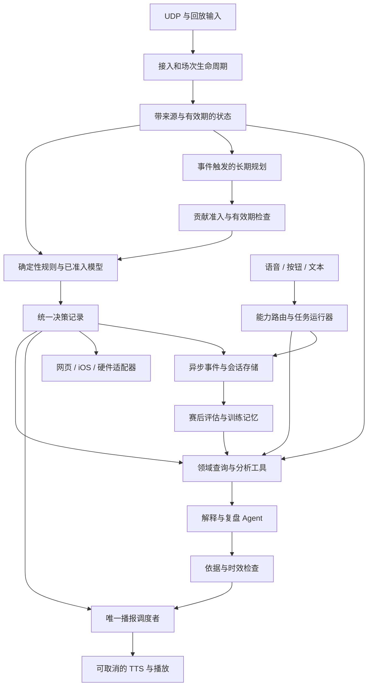

# Asurada 框架改进评估

评估日期：2026-09-15。以 `/Users/sn5/Asurada` 当前工作区为依据，包含已有未提交与未跟踪代码。本文提出改造建议；本轮新增审查材料和本地验证脚本，未修改业务实现。

**核心建议：保留确定性赛车决策内核，统一事实、任务和输出的运行机制，再把 Agent 能力扩展到有证据支撑的查询、规划和赛后训练。**

当前最需要解决的是同一事实产生不同结论、任务超时与取消不能完整落实、实时与非实时工作共享执行链的问题。引入通用 Agent 框架不能自动解决这些问题。已有场次路由、模型准入、置信度与降级、回放链路都值得复用。

**1. 当前代码真正实现了什么**

| 范围 | 当前实现 | 架构判断 |
| --- | --- | --- |
| 实时核心 | UDP / capture 共用 `StrategyRuntimePipeline`；解码、组帧、状态、规则、小模型、仲裁、输出、日志顺序执行 | 已有可用的领域内核，但执行隔离不充分 |
| 模型 | 14 个准入名称，默认 12 个 observe、2 个 disabled，没有默认 active 模型 | 观察与生效权限已区分；观察模型仍同步消耗计算时间 |
| 长期规划 | `PitWindowSupport` 与 `LongHorizonStrategyBaseline` 每次 evaluate 调用；部分结果进入仲裁加减分 | 已有行为影响，不能全部归类为 debug |
| 语音 | ASR、关键词识别、语义归一化、路由、结构化回答、LLM 单次解释、TTS | 路由型助手已成型；尚未看到完整的持久任务执行循环 |
| 任务 | `TaskHandle`、`TaskLifecycleEvent`、snapshot binding 已定义 | 已有任务描述与日志契约；缺少贯穿执行器的 deadline、取消与恢复机制 |
| 记忆 | 120 帧短窗口；会话上下文默认保存 6 条各类记录；辅助模式保存 JSON 状态 | 已有局部状态保存；缺少统一场次生命周期和驾驶员长期训练记忆 |
| 展示 | 网页消费核心 payload；ESP32 通过独立浏览器渲染适配器接收图像块 | 可以保持视觉与设备适配层，优先改接口 |
| iOS | 独立 UDP→JSON 桥接；AppState 承担接入、状态、圈记录、分析和 Live Activity | 与 Python 核心存在数据解释和领域判断的分叉 |

主链入口见 [app.py](/Users/sn5/Asurada/asurada-core/src/asurada/app.py:34)、[runtime_pipeline.py](/Users/sn5/Asurada/asurada-core/src/asurada/runtime_pipeline.py:41) 和 [strategy.py](/Users/sn5/Asurada/asurada-core/src/asurada/strategy.py:82)。模型默认权限见 [model_admission.py](/Users/sn5/Asurada/asurada-core/src/asurada/model_admission.py:23)。

**2. 优先统一决策事实与解释来源：P0**

这是本轮最直接的业务一致性问题。用同一份本地构造快照验证：

| 输入/结果 | 实测 |
| --- | --- |
| 当前燃油覆盖 | 12.4 圈 |
| 剩余赛程 | 13 圈 |
| 策略核心 | `fuel_state=critical`，主动作 `LOW_FUEL` |
| `fuel_status` 查询 | “燃油余量正常。当前预计还能跑 12.4 圈，总圈数 20 圈。” |

原因是核心按剩余赛程和燃油来源判断，而回答层按 `<=3 / <=8 / >8` 重新判断。[strategy.py](/Users/sn5/Asurada/asurada-core/src/asurada/strategy.py:354)、[response_composer.py](/Users/sn5/Asurada/asurada-core/src/asurada/response_composer.py:416)。这属于确定性代码之间的冲突，增加 LLM 能力不会消除它。

建议引入结构化 `AssessmentResult` 和 `DecisionRecord`：前者保存领域事实和判断，后者保存最终动作、依据、候选、抑制原因和版本。结构化回答、LLM 解释、HUD、赛后报告都消费同一份记录。回答层只选择信息和表达方式，不再计算另一套燃油、风险、攻防结论。

例如燃油评估应统一返回 `remaining_race_laps`、`estimated_fuel_laps`、`margin_laps`、`source`、`quality` 和 `verdict`。用户问“为什么省油”时，可以直接指向负余量，而不是让解释层从零重推。

现有 `StrategyDecision` 主要由 `messages + debug` 组成，多个业务模块深读 debug 字典。建议先把已被业务消费的字段提升为显式类型，再逐步拆分 debug；无需一次搬迁全部字段。[models.py](/Users/sn5/Asurada/asurada-core/src/asurada/models.py:139)、[attack_mode.py](/Users/sn5/Asurada/asurada-core/src/asurada/attack_mode.py:91)。

验收：同一快照的策略提示、直接查询和解释在数值与结论上保持一致；解释引用的决定和快照可追溯。

**3. 把 deadline、取消和播报调度做成真实运行机制：P0**

本地假后端复现了三个明确事实：

- LLM 配置超时 20 ms，假后端等待 250 ms，调用实际约 255 ms 才返回 `llm_timeout`。`ThreadPoolExecutor` 的上下文管理退出会等待工作结束，外层捕获超时并没有形成及时返回的保证。现有回归只检查 timeout 状态，没有限制返回耗时。[llm_explainer.py](/Users/sn5/Asurada/asurada-core/src/asurada/llm_explainer.py:455)、[phase3_llm_explainer_regression.py](/Users/sn5/Asurada/asurada-core/scripts/phase3_llm_explainer_regression.py:137)。
- 当前播报 `ERS_LOW` 时提交 `SAFETY_CAR`，即使带 `interrupt=true`，结果仍为 enqueue。仲裁器计算了中断意图，输出队列没有消费这一字段。[arbiter.py](/Users/sn5/Asurada/asurada-core/src/asurada/arbiter.py:247)、[output.py](/Users/sn5/Asurada/asurada-core/src/asurada/output.py:498)。
- sidecar 播放后端 `stop()` 明确为空操作；上层仍可清空 active 并记录 cancel。因此取消日志不能证明音频已经停止。该项来自实现检查，未进行物理音频测试。[tts_backends.py](/Users/sn5/Asurada/asurada-core/src/asurada/tts_backends.py:203)、[output.py](/Users/sn5/Asurada/asurada-core/src/asurada/output.py:1103)。

此外，核心进程与 macOS voice loop 各自构造 `ConsoleVoiceOutput`；voice loop 的 `--use-sidecar-tts` 还会在 Null 后端之外直接调用播放。统一类名和数据结构，并不等于运行时只有一个声音调度者。[app.py](/Users/sn5/Asurada/asurada-core/src/asurada/app.py:38)、[phase3_macos_voice_loop.py](/Users/sn5/Asurada/asurada-core/scripts/phase3_macos_voice_loop.py:161)。

建议：

- 由一个 `SpeechScheduler` 负责主动提示、问答、提醒和所有播放后端，明确每类内容的优先级、可中断性、到期时间及去重范围。
- 使用贯穿 ASR / LLM / TTS / 播放器的 task ID 和 cancellation token；记录 `cancel_requested` 与 `cancelled` 的区别，等待底层停止确认。
- 每个请求只有一个单调时钟 deadline。重试和后备后端使用剩余预算，不为每一层重新发放完整超时。
- 对可协作后端传递取消信号；对无法中断的阻塞调用使用有并发上限的独立执行单元，并丢弃晚到结果。仅调用 `future.cancel()` 不能停止已经运行的线程。
- pending 内容开始播放前重新核验场次、快照年龄、动作是否仍成立。队列应有独立调度时钟或完成回调，避免仅依赖下一次遥测提交推进。
- 播放期间的用户打断，需要输入链路也能接收。当前 voice loop 会基于播放状态跳过监听；AEC、PTT 或独立停止通道应与播放取消一起验证。

验收：慢后端超时后及时返回且并发数量有上限；取消后不会播出旧回复；高优先级提醒按策略抢占；没有新遥测时队列也能正确结束。真实麦克风、声学回声和播放器停止时延需要单独实测。

**4. 分离实时处理、低频规划与持久化：P0/P1**

当前单包调用链包含：解码、组帧、策略、输出和日志。策略内包含全部观察模型以及长期规划；日志执行文件打开、序列化、写入，实时 feed 也逐快照写文件。`pipeline_latency_ms` 在 logger.append 前记录，既不含后续日志写入，也不能代表 UDP 到实际发声的总时延。[runtime_pipeline.py](/Users/sn5/Asurada/asurada-core/src/asurada/runtime_pipeline.py:41)、[replay.py](/Users/sn5/Asurada/asurada-core/src/asurada/replay.py:30)、[live_dashboard_feed.py](/Users/sn5/Asurada/asurada-core/src/asurada/live_dashboard_feed.py:20)。

建议按工作时效拆执行单元：

| 工作 | 触发方式 | 拥塞时行为 |
| --- | --- | --- |
| UDP 接入与必要状态更新 | 随输入处理 | 有界缓存，记录丢包/积压；维护最新有效状态 |
| 短周期规则与已准入模型 | 固定预算或有效新快照 | 不等待解释、持久化或展示 |
| 观察模型 | 受限工作池，可配置采样频率 | 可跳过过期工作，标记结果对应快照 |
| 进站与长期规划 | 新圈、轮胎/天气/对手进站等事件，加低频兜底 | 用明确 TTL 的最近有效结果 |
| 语音解释 | 用户问题或已触发任务 | 超时回退；丢弃过期回复 |
| 日志、报告、展示 | 异步消费事件或最新状态 | 分别定义缓冲、持久化和刷新策略 |

第一版可保持一个代码仓库和模块化核心，只将容易阻塞的工作隔离到工作线程/进程。选择进程还是线程应由 CPU、底层库行为和故障恢复要求决定，不需要先上分布式基础设施。

**5. 为状态增加场次生命周期、来源和有效期：P0/P1**

`UnifiedStateStore.update()` 直接向 deque 追加；本地验证在 A 场后写入 B 场，recent(12) 同时包含两个场次。核心按 session 保存部分战术状态，但 history 本身没有场次隔离。`ConversationContext` 也没有统一切场 reset。[state.py](/Users/sn5/Asurada/asurada-core/src/asurada/state.py:15)、[conversation_context.py](/Users/sn5/Asurada/asurada-core/src/asurada/conversation_context.py:25)。

组帧器要求六类包同一 frame 凑齐；跨帧的 Session、Event、Participants 等缓存主要保存 body，缺少可统一检查的年龄。当前适配器的结构对掉包、乱序、低频字段以及 flashback/重开需要专门验收，不应直接假定已经覆盖。[packet_snapshot.py](/Users/sn5/Asurada/asurada-core/src/asurada/packet_snapshot.py:100)。

LLM 的非比赛遮罩会清掉 state_snapshot 中的数值，但仍保留 strategy_snapshot 与 conversation_snapshot 中的旧策略。本地验证确认这一结构；它构成上下文混用风险，尚未证明真实模型会输出错误赛况。[state_summary_for_llm.py](/Users/sn5/Asurada/asurada-core/src/asurada/state_summary_for_llm.py:83)。

建议建立 `SessionLifecycle` 和统一时间接口：

- 用 session UID 加 epoch 区分新比赛、重开和倒带；统一重置窗口、辅助提醒、旧任务与会话内记忆。
- 使用时间窗口表达“最近 1 秒”等语义，不把固定 12 帧假定为固定时长。
- 遥测字段至少区分 value、source、observed_at、quality；缺失/过期与真实零值分开。
- 为高频关键字段和低频辅助字段分别定义可用条件；不能简单复用旧值而不报告年龄。
- 区分游戏时间、接收墙钟与耗时用单调时钟。Replay 使用可注入时钟，避免历史时间戳被误判成当前断流。
- 用户提问结束时读取最新状态；需要解释历史提示时显式绑定历史 decision ID。播报前再验有效性。

**6. 扩大“准入”的范围，并修正缺失值语义：P0/P1**

`ModelAdmissionPolicy` 已经是很好的基础，但只约束列出的模型。长期规划的确定性公式同样会影响 `ATTACK_WINDOW / DEFEND_WINDOW / BOX_WINDOW / TYRE_MANAGE` 的排序，应有独立的行为准入与验证记录。[strategy.py](/Users/sn5/Asurada/asurada-core/src/asurada/strategy.py:943)、[arbiter.py](/Users/sn5/Asurada/asurada-core/src/asurada/arbiter.py:356)。

另一个本地复现：不给仲裁器任何 sidecar 分数时，LOW_FUEL 优先级从 95 变成 85，DYNAMICS_UNSTABLE 从 72 变成 64。因为缺失 score 被转换为 0，随后触发“低风险”减分。观察与关闭模型输出一致的测试不能发现这个问题，因为两边都会走同样的缺失路径。[arbiter.py](/Users/sn5/Asurada/asurada-core/src/asurada/arbiter.py:490)。

建议将影响决策的每一项贡献注册为 `DecisionContributor`，统一携带来源、版本、是否生效、适用场次、有效期和证据。缺失输出返回 unavailable；只有有效、已准入的输出才能加减分。对长期规划先固定现有行为基线，再通过独立开关和差分回放迁移，避免重构时悄悄改变策略。

模型 active 目前只要求 evidence 字符串非空。发布时进一步绑定模型 hash、特征 schema、评估集版本与验证结果。本次发现的 24 份含 model_path 的训练报告均使用绝对路径，需改为可迁移资产包中的相对路径或受控解析规则。[model_runtime.py](/Users/sn5/Asurada/asurada-core/src/asurada/model_runtime.py:203)。

**7. 用能力注册表支撑扩展，再增加有边界的 Agent 循环：P1**

当前增加一个语音能力，往往要同步修改关键词、语义推断、能力集合、路由、字段选择、回答分支、输出控制和测试。`interaction.py` 1152 行，`response_composer.py` 1156 行，其中 `compose_structured_query_response()` 单函数 741 行；`output.py` 1430 行。问题在于职责和规则分散，文件长度只是信号。

建议把当前 CapabilityRegistry 从“允许的 query_kind 集合”提升为唯一能力定义入口：

```text
CapabilitySpec
  name / input_schema / output_schema
  handler / required_facts / supported_session_modes
  permission_scope / freshness_policy / deadline_policy
  speech_policy / version
```

处理函数按 fuel、tyres、rivals、pit、driving、session 等领域拆分。规则判断留在领域服务，注册表描述如何调用，不把复杂业务全部改写成配置 DSL。

由同一份定义提供用户界面、语音路由、工具 schema 和测试覆盖清单。快速停止、状态查询保持短路径。LLM 可在范围内选择工具、追问和组织结果；无需为了每个能力启动一个独立 Agent。

第一批适合开放给 Agent 的工具是：读取状态、读取决定及理由、读取圈/弯道摘要、比较两圈、查询进站规划依据、生成训练计划草稿。所有比赛数值由确定性工具返回；比赛提示权限与解释工具权限分开。

建议增加的任务流程：接收请求 → 绑定状态/历史范围 → 选择有限工具 → 执行 → 检查证据和时效 → 回答/生成报告 → 保存结果。工具次数、运行时间、模型调用次数和并发都要有明确上限；任务状态至少区分 queued、running、completed、failed、cancelled、expired。

对应用户价值的例子是：“分析我最近三圈 T14 为什么慢，给出下一圈一条训练重点。”系统先取真实圈和弯道数据、做可重现比较，再组织训练反馈，下一圈结束后检查表现变化。这比继续扩充同义句分支更能形成持续使用价值。

**8. LLM 边界应校验依据和输出用途：P1**

目前 schema 检查大多是字段和类型。`reason_fields` 没有验证是否真的存在于本次事实中；普通文本解析失败后可被包装成 answerable，并赋固定 confidence=0.55。本地输入任意包含赛况数字的文本，能通过此结构验证；这证明校验缺口，不代表已发生真实云端错误回答。另外 NaN confidence 也能通过范围校验。[llm_response_schema.py](/Users/sn5/Asurada/asurada-core/src/asurada/llm_response_schema.py:23)、[llm_explainer.py](/Users/sn5/Asurada/asurada-core/src/asurada/llm_explainer.py:526)。

建议把输出分成 answer、evidence_refs、uncertainty 和 proposed_action；引用必须能在请求绑定的事实/决定中解析，缺失数据不能生成当前赛况数字。比赛解释 lane 对格式错误回退到领域模板，陪聊 lane 可以采用不同的表达约束。对未来推演返回工具的假设、范围和不确定性。

输出验证器优先保证可机器检查的部分：数值、单位、时效、引用、动作权限和与最终决定的一致性；不能声称仅用 JSON schema 就能消除所有语言幻觉。

**9. 统一多端契约，保留展示适配器：P1**

建议定义版本化的 `TelemetrySnapshot`、`DecisionRecord`、`VoiceEvent`、`SessionEvent`，由一个权威接入/领域层产出，网页、iOS 和硬件适配器各取所需投影。

当前 iOS 的 UDP bridge 单独维护包布局和赛道表；AppState 约 1356 行，混合网络接入、JSON/CSV 解析、圈管理、车损判断、UI 状态和 Live Activity。应逐步拆为 TelemetryClient、SessionStore、LapRepository、DamagePresentation 和界面状态，不必先重新设计页面。[f1_25_udp_to_serial_bridge.py](/Users/sn5/Asurada/ios-racetrack-analytics/app/AsuradaRaceReplayPrototype/scripts/f1_25_udp_to_serial_bridge.py:32)、[AppState.swift](/Users/sn5/Asurada/ios-racetrack-analytics/app/AsuradaRaceReplayPrototype/Models/AppState.swift:23)。

网页服务器目前自写 HTTP/WebSocket 处理，广播对客户端顺序 sendall，没有独立慢消费者队列；适合在服务化时更换成熟传输实现，并限制每个客户端积压。核心 feed 的原子替换可以保留为过渡方式，但历史 session_log 不宜继续充当实时查询接口。[server.py](/Users/sn5/Asurada/live-dashboard/server.py:130)、[phase3_macos_voice_loop.py](/Users/sn5/Asurada/asurada-core/scripts/phase3_macos_voice_loop.py:310)。

ESP32 的 RGB565、CRC、增量块和 ACK 机制可继续作为独立显示适配器；本轮协议测试 4/4 通过。其浏览器渲染路径是否要改成原生渲染，应由目标设备和实测资源成本决定，不属于本次核心改造的前置条件。

**10. 让评估与训练证明用户收益：P1/P2**

训练导出中的部分 label 直接取自现有规则的 assessment、risk_profile 和最终 action，函数也明确标注为 pseudo-label。因此拟合准确率首先说明模型复现这些标签的能力，不能直接说明模型优于现有规则。[export_phase2_training_data.py](/Users/sn5/Asurada/asurada-core/scripts/export_phase2_training_data.py:1007)。

资源模型会从 train 行随机切 validation；strategy-action 虽有固定分割，但也包含同场按 frame 取模分配 train/val/test 的特殊分支；趋势模型按场次类型和圈号分割。这些适合现阶段实验，但需要独立的跨完整场次、赛道和驾驶员验证集，未来标签还要设置覆盖预测窗口的时间间隔，避免相邻样本使结果过于乐观。[train_resource_risk_baselines.py](/Users/sn5/Asurada/asurada-core/scripts/train_resource_risk_baselines.py:256)、[export_phase2_training_data.py](/Users/sn5/Asurada/asurada-core/scripts/export_phase2_training_data.py:1267)。

建议分别评估：

| 层次 | 应证明什么 |
| --- | --- |
| 数据 | 缺失、乱序、重包、切场、倒带时仍可正确识别当前有效状态 |
| 决策 | 哪些情境需要提醒、何时提醒、是否压过更重要信息；人工标注与规则基线比较 |
| 模型 | 真实目标预测、校准、适用条件和跨场次泛化，区分伪标签与观测结果 |
| 交互 | 语义路由、真实 deadline、停止播放、过期拒绝、误唤醒和重复播报 |
| 解释 | 引用正确、数字正确、与决定一致、缺失时明确说明 |
| 产品 | 提示干扰、关键提醒漏报、用户采纳和训练表现变化 |

新增完整会话轨迹：telemetry → decision → task → tool → speech → outcome，以统一 ID 关联。日志保存规则/模型/提示词/特征版本。现有 JSONL 回放和回归脚本继续使用，再补行为指标；不必先重写所有测试框架。

长期记忆建议分为本场事实、已验证的驾驶表现、用户偏好三类，分别管理有效期和来源。数值时序与圈分析先使用结构化存储，语义检索留给训练笔记与解释文档。可以从本地 SQLite 的任务/会话索引及文件中的遥测开始；后续存储选型按数据量再决定。

**11. 建议的目标结构**



稳定边界是 contracts、domain、runtime、agent、adapters、evaluation。Agent 框架及具体模型放在边界之后，允许替换。近期 Anthropic 的 Managed Agents 设计也把推理执行循环、工具执行环境和会话事件独立出来；这里借鉴接口与恢复思想，具体落地按本地赛车产品的规模缩减。[官方工程说明](https://www.anthropic.com/engineering/managed-agents)

上下文应按任务选取相关证据，并区分当前事实、历史记录和长期记忆；这与当前 context engineering 的实践方向一致。[Anthropic 上下文工程](https://www.anthropic.com/engineering/effective-context-engineering-for-ai-agents)

框架选择建议：近期保留 Python 领域内核与现有 provider 适配；先做显式任务状态机。若赛后流程确实需要多步骤恢复、检查点和跨会话存储，可以在该层评估 LangGraph；其 checkpointer 与 store 分别解决单任务状态和跨任务信息持久化。是否采用以一个真实复盘流程的改造收益为准。[LangGraph 持久化文档](https://docs.langchain.com/oss/python/langgraph/persistence)

**12. 建议推进顺序**

以下是单名熟悉项目的开发者的工作量估计，用于排序，不是交付承诺；不包含真实硬件声学验收和新数据采集。

| 阶段 | 内容 | 估计 | 退出条件 |
| --- | --- | --- | --- |
| A | 固定工作区基线；补本轮问题的行为验收；统一燃油等首批领域事实；修 deadline 和缺失值语义 | 3–5 人日 | 同快照回答一致；超时及时返回；未提供的模型分数不影响排序 |
| B | 统一任务取消与声音所有权；场次 reset；队列 TTL；异步日志和慢任务隔离 | 5–8 人日 | 慢任务不拖慢实时链；旧场/过期内容不播；停止落到实际后端 |
| C | 版本化数据契约；能力注册表；小模型/规划贡献准入；移动端共享投影 | 5–8 人日 | 新能力只有一份定义；端侧与核心字段和结论一致 |
| D | 一个可恢复的赛后 Agent 流程：三圈弯道比较 → 一条训练重点 → 后续表现检查 | 5–10 人日 | 每条建议有证据，任务可恢复，训练效果可比较 |

最适合先改的三个边界是：`AssessmentResult/DecisionRecord`、贯穿调用的 `TaskContext`、唯一 `SpeechScheduler`。这三项能够直接消除已复现问题，也为后续 Agent 工具、记忆和规划提供基础。

**13. 审查与验证范围**

全量结构扫描覆盖 198 个一方源码及配置文件、53,103 行，包含：核心运行模块 69 个/22,950 行、核心脚本 90 个/19,295 行、网页 4 个/2,131 行、ESP32 7 个/399 行、iOS 源码及项目配置 20 个/5,302 行，以及入口、采集工具与文档生成脚本。所有扫描到的 Python 文件均可 AST 解析。统计包含采集工具的重复副本；排除依赖、构建产物、运行日志、遥测原始数据和与 Asurada 无关的 security-test 报告。

阅读深度分层：对核心决策、语音路由、任务/输出、状态组装、训练标签/分割及端侧接入进行了重点调用链与实现审查；其余脚本和展示代码做结构、职责和关联检查。198 个文件的结构扫描不等同于对 53,103 行逐行审计，也不等同于穷尽所有运行路径。

本轮实际运行：

- 12 项选定 Python 回归：12 passed，0 failed，0 skipped；环境具备 LightGBM。包括模型准入/编码、长期规划历史、场次路由、语音语义、LLM 边界/超时状态和输出控制。
- ESP32 显示协议的 4 项 Node 测试：4 passed；覆盖 CRC、全帧、增量和损坏检测。
- 8 组本地架构探针：记录超时、文本校验、NaN、缺失模型分数、跨场次历史、燃油结论冲突、语音抢占和过期上下文的当前行为。它们用于复现问题，不是“8 项功能验收通过”。

本轮没有验证真实比赛 UDP、云 ASR/LLM/TTS、物理麦克风/扬声器、iOS 设备或 ESP32 实机，也没有重跑完整捕获回放和全部回归。历史验收数据仅用于定位，未作为本轮已通过结果。

材料：

- [源码清单与内容指纹](/Users/sn5/Asurada/output/architecture-review-2026-09-15/source-inventory.json)
- [12 项回归结果](/Users/sn5/Asurada/output/architecture-review-2026-09-15/regressions/summary.json)
- [本地探针脚本](/Users/sn5/Asurada/output/architecture-review-2026-09-15/probes.py)
- [本地探针结果](/Users/sn5/Asurada/output/architecture-review-2026-09-15/probes.json)
